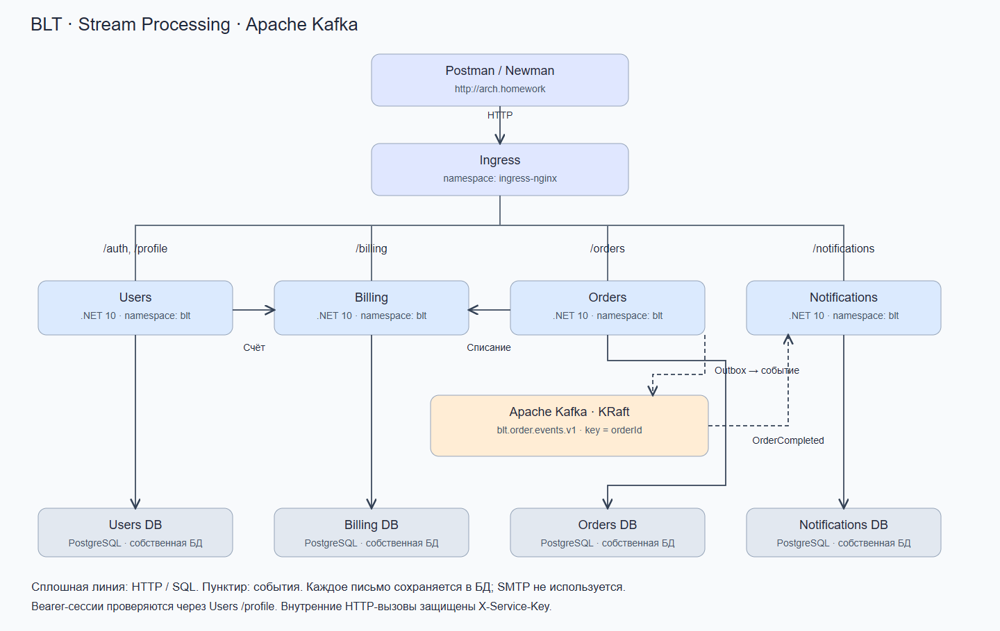

# Домашнее задание №8 — Stream Processing

Сервисы заказов, биллинга и уведомлений на .NET 10, PostgreSQL и **Apache Kafka**.
Регистрация создаёт счёт; заказ списывает деньги через Billing и публикует
результат в Kafka. Notifications сохраняет «Письмо счастья» или «Письмо горя».

## Материалы для сдачи

- [Архитектура, три варианта взаимодействия и инструкция](docs/streaming/README.md).
- [Схема сервисов — PNG](docs/streaming/architecture.png).
- Sequence-диаграммы: [HTTP](docs/streaming/http-only.png),
  [HTTP + Kafka](docs/streaming/http-kafka.png),
  [Event Collaboration](docs/streaming/event-collaboration.png).
- IDL: [OpenAPI](docs/streaming/openapi.yaml),
  [AsyncAPI](docs/streaming/notifications.asyncapi.yaml); контракты теоретических
  вариантов доступны в инструкции.
- [Helm-чарт](helm/blt-streaming).
- [Postman-коллекция](postman/homework-8.postman_collection.json) и
  [окружение](postman/homework-8.postman_environment.json): `{{baseUrl}}` = `http://arch.homework`.
- [Результаты проверок](docs/results/streaming/README.md).



## Запуск

Из корня репозитория, PowerShell 7, Docker Desktop с Linux containers запущен:

```powershell
./scripts/setup-streaming.ps1
./scripts/test-streaming.ps1 -BaseUrl http://127.0.0.1:8098
```

Скрипт создаёт kind-кластер `otus-hw8`, собирает и загружает четыре образа.
Приложения, БД и Kafka устанавливаются в namespace **`blt`**,
ingress controller — в **`ingress-nginx`**. Kubeconfig:
`.local/kubeconfig-streaming`. Newman выводит запросы и ответы.

Команда установки приложения в подготовленный кластер:

```powershell
helm upgrade --install blt-streaming ./helm/blt-streaming --namespace blt --create-namespace --wait --wait-for-jobs --timeout 10m
```

Автотесты с временными PostgreSQL в Docker:

```powershell
dotnet test Blt.slnx
```

Предыдущие работы: [ДЗ №4](docs/homework-4.md), [№5](docs/homework-5.md),
[№6](docs/homework-6.md), [№7](docs/authentication.md).
