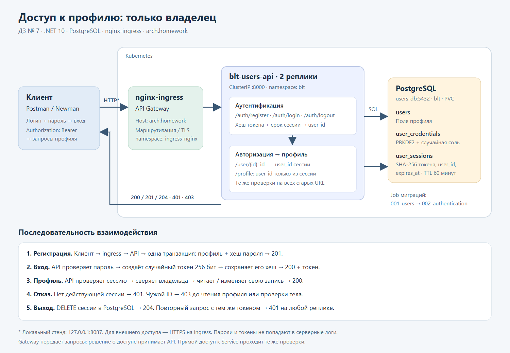

# Домашнее задание № 7 — аутентификация и авторизация

Регистрация, вход, просмотр и изменение собственного профиля на .NET 10 и
PostgreSQL. Без действующей сессии API возвращает **401**, при обращении к
чужому профилю — **403**. Выход отзывает токен на всех репликах приложения.

## Материалы для сдачи

- [Архитектура, установка, namespaces и запуск тестов](docs/authentication.md).
- [Схема взаимодействия сервисов — PNG](docs/authentication-architecture.png)
  и [исходник SVG](docs/authentication-architecture.svg).
- [Helm-чарт](helm/blt-users-api) и [Kubernetes-манифесты](k8s).
- [Postman-коллекция](postman/homework-7.postman_collection.json) и
  [окружение](postman/homework-7.postman_environment.json): `baseUrl = http://arch.homework`.
- [OpenAPI](docs/openapi.yaml).
- [Результаты проверок](docs/results/authentication/README.md).



## Локальный запуск

Из корня репозитория, PowerShell, Docker Desktop запущен:

```powershell
./scripts/setup-auth.ps1
./scripts/test-auth.ps1 -BaseUrl http://127.0.0.1:8087
```

Первый скрипт создаёт отдельный kind-кластер `otus-hw7`, собирает и загружает
образ `7.0.0`, устанавливает nginx-ingress в **`ingress-nginx`**, PostgreSQL и
приложение в **`blt`**. Используется `.local/kubeconfig-auth`.
Коллекция передаёт `Host: arch.homework`; изменять системный hosts для этого
запуска не требуется. Newman выводит данные запросов и ответов, маскируя секреты.

Команда установки приложения в подготовленный кластер с PostgreSQL:

```powershell
helm upgrade --install blt-users-api ./helm/blt-users-api --namespace blt --create-namespace --wait --timeout 5m
```

Подготовка образа, БД, установка ingress и вариант из манифестов описаны
в [инструкции](docs/authentication.md). HTTP используется для локального стенда;
внешний доступ требует HTTPS.

Автотесты с временной PostgreSQL в Docker:

```powershell
dotnet test Blt.slnx
```

Предыдущие работы: [ДЗ № 4](docs/homework-4.md), [ДЗ № 5](docs/homework-5.md),
[ДЗ № 6](docs/homework-6.md). Их коллекции CRUD относятся к API до введения авторизации.
