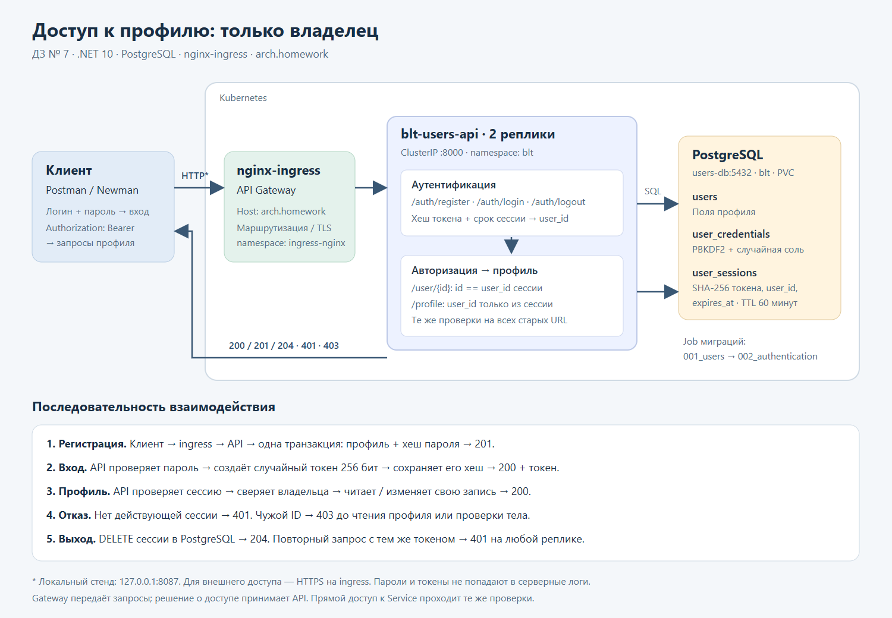

# ДЗ № 7: безопасный пользовательский профиль

## Архитектурное решение



[PNG для сдачи](authentication-architecture.png), [редактируемый SVG](authentication-architecture.svg).

nginx-ingress принимает запросы к `arch.homework` и направляет их в Kubernetes
Service `blt-users-api:8000`. За Service работают две реплики .NET API.
Аутентификация и авторизация выполняются внутри API, поэтому прямое обращение
к Service и прежние альтернативные URL проходят те же проверки.
Отдельный сервис авторизации и дополнительный API Gateway для этой работы не нужны.

| Компонент | Namespace | Назначение |
|---|---|---|
| nginx-ingress | `ingress-nginx` | Маршрутизация по Host, TLS при внешнем доступе |
| blt-users-api | `blt` | Регистрация, вход, выход, проверка владельца, профиль |
| users-db / PostgreSQL | `blt` | Профили, хеши паролей, сессии; данные на PVC |
| blt-users-api-migrations | `blt` | Job перед запуском/обновлением приложения |

Регистрация одной транзакцией создаёт запись `users` и связанную запись
`user_credentials`. Пароль хранится через ASP.NET Core Identity PasswordHasher:
PBKDF2-HMAC-SHA512, 220 000 итераций, индивидуальная случайная соль.
Валидация допускает пароли длиной 12–128 символов, не обрезает их и не меняет регистр.
`username` и `email` уникальны; пробелы по краям полей профиля удаляются,
сравнение логина остаётся регистрозависимым, как в исходной таблице пользователей.

При входе API сверяет пароль и выдаёт случайный непрозрачный bearer-токен
с 256 битами случайности. В `user_sessions` сохраняются только SHA-256 токена,
`user_id` и срок действия. Это серверная сессия; её состояние общее для всех
реплик благодаря PostgreSQL. Каждый защищённый запрос заново проверяет сессию
и срок действия. По умолчанию срок — 60 минут, настройка Helm
`session.lifetimeMinutes` / переменная `Session__LifetimeMinutes`, диапазон 1–1440.
Просроченные записи удаляются при следующем успешном входе; уже истёкшая сессия
отклоняется независимо от физического удаления записи.

Из проверенной сессии формируется `NameIdentifier`. Политика `ProfileOwner`
сравнивает его с ID в URL **до чтения профиля и привязки тела запроса**.
Другой ID, включая несуществующий, возвращает 403 без полей профиля.
Для `/profile` ID берётся только из сессии. Заголовки `X-User-Id`, cookies,
query-параметры и поле `id` в JSON не назначают владельца.
Глобальная fallback-политика требует входа; публичными явно объявлены только
регистрация, вход и служебные `/health`, `/ready`, `/metrics`.

Выход удаляет текущую сессию из БД. После завершения запроса выхода её токен
больше не проходит аутентификацию ни на одной реплике; другие сессии того же
пользователя остаются действующими. Удаление собственного профиля каскадно
удаляет все его учётные данные и сессии.

Ошибки входа для неизвестного пользователя и неверного пароля одинаковы;
для неизвестного пользователя также выполняется дорогая проверка хеша.
Вход и регистрация вместе ограничены 30 запросами в минуту на реплику;
превышение возвращает 429 и `Retry-After: 60`. Это локальный лимит процесса,
при двух репликах суммарный предел может достигать 60 запросов в минуту.
Пароли и токены не записываются в серверные логи; API выставляет
`Cache-Control: no-store`. При недоступности БД проверка сессии возвращает 503,
доступ к профилю не предоставляется.

Использованные основы: [аутентификация и политики ASP.NET Core](https://learn.microsoft.com/en-us/aspnet/core/fundamentals/minimal-apis/security?view=aspnetcore-10.0),
[хранение паролей OWASP](https://cheatsheetseries.owasp.org/cheatsheets/Password_Storage_Cheat_Sheet.html),
[управление сессиями OWASP](https://cheatsheetseries.owasp.org/cheatsheets/Session_Management_Cheat_Sheet.html).

## API

Полный контракт: [openapi.yaml](openapi.yaml).

| Метод и URL | Доступ | Результат |
|---|---|---|
| `POST /auth/register` | Без входа | 201, профиль без пароля и без автоматического входа |
| `POST /auth/login` | Без входа | 200, `accessToken`, `tokenType`, `expiresAt`, `userId` |
| `POST /auth/logout` | С действующим токеном | 204, текущая сессия отозвана |
| `GET /profile` | Своя сессия | 200, собственный профиль |
| `PUT /profile` | Своя сессия | 200, изменённый собственный профиль |
| `GET /user/{id}` | Только владелец | 200 / 401 / 403 |
| `PUT /user/{id}` | Только владелец | 200 / 401 / 403 |
| `DELETE /user/{id}` | Только владелец | 204, удаление вместе с сессиями |
| `GET /user` | С действующим токеном | Массив только со своим профилем |

В профиле: `id`, `username`, `firstName`, `lastName`, `email`, `phone`.
Для регистрации дополнительно обязателен `password`; обязательные поля профиля:
`username`, `firstName`, `lastName`, `email`. `PUT` обновляет только переданные
непустые значения. Пропущенные поля и `null` сохраняют прежние значения;
смена пароля этим методом не поддерживается. Ошибки валидации — 400,
занятые username/email — 409. Пароль и хеши не входят в ответы профиля.

Защищённые совместимые префиксы: `/user`, `/users`, `/v1/user`, `/v1/users`,
`/api/v1/user`, `/api/v1/users`, `/otusapp/vyacheslav/user`,
`/otusapp/vyacheslav/v1/user`. Ingress также сохраняет rewrite-префикс
`/otusapp/vyacheslav`. Прежний `POST /user` для создания без пароля удалён.

Токен передаётся только в `Authorization: Bearer <accessToken>`.
Браузер не прикладывает его автоматически как cookie; cookie-аутентификации
и междоменных CORS-разрешений в этом API нет.

## Быстрый локальный стенд

Предварительно: Windows PowerShell или PowerShell 7, Docker Desktop с Linux
containers, `kubectl`, Node.js/npm. Для запуска .NET-тестов нужен .NET 10 SDK.
`kind` и `helm`, если отсутствуют, скрипт загружает в `.tools` внутри репозитория.

```powershell
./scripts/setup-auth.ps1
./scripts/test-auth.ps1 -BaseUrl http://127.0.0.1:8087
```

Скрипт создаёт **`otus-hw7`** с loopback-портом **8087** и kubeconfig
**`.local/kubeconfig-auth`**. Все его команды явно используют этот kubeconfig.
Контекст Kubernetes по умолчанию и кластер предыдущей работы не изменяются.
Повторный запуск применяет Helm upgrade и идемпотентные миграции.
Если образ уже собран, доступен `./scripts/setup-auth.ps1 -SkipBuild`.

```powershell
kubectl --kubeconfig .local/kubeconfig-auth -n blt get pods,svc,ingress,jobs
curl.exe -i -H "Host: arch.homework" http://127.0.0.1:8087/health
curl.exe -i -H "Host: arch.homework" http://127.0.0.1:8087/profile
# Ожидаются 200 и 401 соответственно.
```

## Установка Helm в подготовленный кластер

Команды ниже используют выбранный вами kubeconfig. Для созданного выше kind
добавляйте `--kubeconfig .local/kubeconfig-auth` к `kubectl` и `helm`.
**Приложение и PostgreSQL устанавливаются в namespace `blt`.**

Собрать образ и сделать его доступным нодам. Публикация образа для kind не нужна:

```powershell
docker build --platform linux/amd64 -t vafomenko/blt-users-api:7.0.0 .
kind load docker-image vafomenko/blt-users-api:7.0.0 --name otus-hw7
# Для Minikube вместо kind load:
# minikube image load vafomenko/blt-users-api:7.0.0
```

Gateway — **nginx-ingress**, дополнительный gateway устанавливать не требуется.
Если ingress-nginx ещё не установлен, для kind:

```powershell
helm repo add ingress-nginx https://kubernetes.github.io/ingress-nginx
helm repo update ingress-nginx
helm upgrade --install ingress-nginx ingress-nginx/ingress-nginx --version 4.15.1 --namespace ingress-nginx --create-namespace --values infra/nginx-ingress.yaml --wait --timeout 5m
```

`infra/nginx-ingress.yaml` настраивает NodePort 30080; kind отображает его на
127.0.0.1:8087. Для Minikube можно включить `minikube addons enable ingress`.
При обращении по имени `arch.homework` настройте DNS/hosts на адрес ingress;
для kind используйте URL `http://arch.homework:8087`. Коллекция также позволяет
передать IP через `baseUrl`, сохраняя нужный `Host` автоматически.

База данных и приложение:

```powershell
kubectl apply -f infra/postgresql.yaml
kubectl -n blt rollout status statefulset/users-db --timeout=300s
helm upgrade --install blt-users-api ./helm/blt-users-api --namespace blt --create-namespace --wait --timeout 5m
kubectl -n blt rollout status deployment/blt-users-api --timeout=300s
```

SQL-файлы встроены в сборку. Helm Job `pre-install,pre-upgrade` выполняет
`001_users.sql`, затем `002_authentication.sql` под блокировкой PostgreSQL
и учитывает `schema_migrations`. Старые профили сохраняются без автоматически
назначенного пароля: они не могут войти, а регистрация поверх них возвращает
конфликт. Учебные сценарии создают новые аккаунты со случайными данными.

Для внешнего окружения используйте HTTPS и отдельный Secret БД. Пример values:

```yaml
database:
  existingSecret: blt-users-api-db
ingress:
  tls:
    - secretName: arch-homework-tls
      hosts: [arch.homework]
  annotations:
    nginx.ingress.kubernetes.io/ssl-redirect: "true"
```

Secret `blt-users-api-db` должен содержать `Database__Username` и
`Database__Password`, соответствующие БД, а `arch-homework-tls` — сертификат
и ключ для домена. Учебные `change-me` из манифестов и HTTP предназначены
для локального стенда. Включать `infra/homework-values.yaml` для ДЗ № 7 не нужно:
он включает демонстрационную инъекцию сбоев из прежней работы.

## Установка из обычных манифестов

Альтернатива Helm приложения: образ, PostgreSQL и ingress подготовьте как выше.
**Namespace приложения — `blt`.** Не устанавливайте один экземпляр приложения
одновременно Helm и raw-манифестами с совпадающими именами ресурсов.

```powershell
kubectl apply -f k8s/00-namespace.yaml
kubectl apply -f k8s/01-configmap.yaml -f k8s/02-secret.yaml
kubectl -n blt delete job blt-users-api-migrations --ignore-not-found
kubectl apply -f k8s/03-migration-job.yaml
kubectl -n blt wait --for=condition=complete job/blt-users-api-migrations --timeout=300s
kubectl apply -f k8s/04-deployment.yaml -f k8s/05-service.yaml -f k8s/06-ingress-root.yaml -f k8s/07-ingress-rewrite.yaml
kubectl -n blt rollout status deployment/blt-users-api --timeout=300s
```

## Postman / Newman

Импортируйте [коллекцию](../postman/homework-7.postman_collection.json) и
[окружение](../postman/homework-7.postman_environment.json).
В обоих экспортированных файлах исходное значение **`baseUrl = http://arch.homework`**;
все URL запросов используют **`{{baseUrl}}`**. На каждой итерации генерируются
новые UUID, логины, пароли, имена, email и телефоны.

Запуск при настроенном домене и ingress на порту 80:

```powershell
npx --yes newman@6.2.1 run postman/homework-7.postman_collection.json --environment postman/homework-7.postman_environment.json --reporters cli --color off --timeout-request 15000 --bail
```

Запуск локального kind без изменения hosts:

```powershell
./scripts/test-auth.ps1 -BaseUrl http://127.0.0.1:8087
```

25 запросов последовательно проверяют регистрацию пользователя 1, запрет
чтения/изменения без входа, неверный пароль, вход, изменение всех полей,
чтение сохранённых данных, выход и повторное использование отозванного токена.
Затем регистрируется и входит пользователь 2; его чтение, изменение и удаление
чужого профиля возвращают 403, в том числе через альтернативные URL.
Список пользователей показывает только его самого. Повторный вход пользователя 1
подтверждает, что чужие попытки не изменили данные. Последние два запроса
удаляют только созданные этой итерацией профили и их сессии.

Общие pre-request/test-скрипты печатают `REQUEST`, `REQUEST HEADERS`,
`REQUEST BODY`, `RESPONSE`, `RESPONSE HEADERS`, `RESPONSE BODY` через
`console.log`; CLI reporter Newman отображает их в терминале.
Пароль, Authorization и accessToken заменяются на `[REDACTED]` в выводе,
при этом сами HTTP-запросы содержат реальные сгенерированные значения.
Не используйте `--reporter-cli-no-console`: он скрывает эти данные.
Поведение reporter описано в [документации Newman](https://learning.postman.com/docs/reference/newman-cli/newman-built-in-reporters).
Скрипт сохраняет вывод в `.local/auth-results/newman-output.txt` и возвращает
ошибку при провале сценария.

## Автоматическая проверка

```powershell
dotnet test Blt.slnx
helm lint ./helm/blt-users-api
```

Интеграционные тесты сами запускают временный `postgres:17.6-alpine` на случайном
loopback-порту и удаляют контейнер по окончании. Проверяются реальные SQL,
переход со старой схемы и повторные миграции, атомарная конкурентная регистрация,
проверка паролей, срок/подделка/отзыв сессии, несколько экземпляров API,
все восемь префиксов маршрутов и отсутствие доступа к чужим данным.
Служебные маршруты, метрики и структурированные логи проверяются прежними тестами.

Фактические команды и результаты: [отчёт проверки](results/authentication/README.md).
