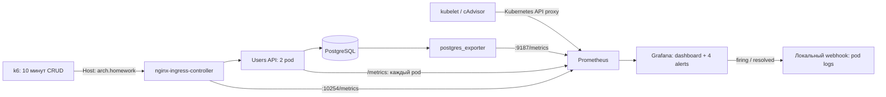

# Метрики и алерты - ДЗ № 5

Сервис из ДЗ № 4 сохранён: .NET 10, PostgreSQL, первоначальная миграция Job,
две реплики, Helm, основной Ingress и rewrite-маршрут. ДЗ № 5 добавляет
инструментирование HTTP и самостоятельный стек Prometheus + Grafana.
Для воспроизводимого стенда PostgreSQL разворачивается из официального образа
через [StatefulSet](../infra/postgresql.yaml); values Bitnami из ДЗ № 4 сохранены.

## Сбор данных



Prometheus опрашивает источники каждые 10 секунд. Приложение обнаруживается
через Kubernetes endpoints: обе реплики имеют отдельные временные ряды.
Графики используют окно `[1m]`; это шесть интервалов сбора. Все запросы API
фильтруются по `job="blt-users-api",namespace="blt"`, ingress - дополнительно
по `service="blt-users-api"`. Таким образом, чужие ingress не попадают в графики.

## Методы API

| Метод | Label route | Действие |
|---|---|---|
| GET | `/user` | список |
| POST | `/user` | создание |
| GET | `/user/{id}` | получение |
| PUT | `/user/{id}` | изменение |
| DELETE | `/user/{id}` | удаление |

ID, query string и пользовательские данные не используются как labels.
Алиасы `/users`, `/v1/users` и остальные маршруты из ДЗ № 4 объединены
с каноническими маршрутами через endpoint metadata. `/health`, `/ready`,
`/metrics` и неизвестные пути исключены из метрик API.

| Метрика | Тип | Назначение |
|---|---|---|
| `blt_http_requests_total{method,route,status_code}` | counter | RPS, HTTP 500, доля 5xx |
| `blt_http_request_duration_seconds{method,route}` | histogram | p50, p95, p99 |
| `blt_http_request_duration_max_seconds{method,route}` | gauge | точный максимум за последние 60 секунд |

Для квантилей сначала суммируются buckets всех реплик по `le,method,route`,
затем выполняется `histogram_quantile`. Усреднение квантилей разных pod’ов
не используется. Длительность включает middleware, задержку, обработку
ошибок и сериализацию ответа, но не передачу ответа от ingress до клиента.
Время измеряется монотонными часами. Maximum хранит кандидатов в монотонной
очереди и сбрасывается в 0 после минуты простоя, даже если новых запросов нет.

```promql
histogram_quantile(0.95,
  sum by (le, method, route) (
    rate(blt_http_request_duration_seconds_bucket{job="blt-users-api",namespace="blt"}[1m])
  )
)

sum by (method, route) (
  rate(blt_http_requests_total{job="blt-users-api",namespace="blt"}[1m])
)

sum by (method, route) (
  increase(blt_http_requests_total{job="blt-users-api",namespace="blt",status_code="500"}[1m])
)
```

## Ingress и значение max

Используются стандартные метрики контроллера
`nginx_ingress_controller_request_duration_seconds_bucket` и
`nginx_ingress_controller_requests`. Latency отражает полный запрос с точки
зрения NGINX, поэтому отличается от времени обработчика приложения.

**Стандартный nginx-ingress-controller не экспортирует точный максимум
отдельным gauge.** На панели показан `histogram_quantile(1, ...)` с легендой
`max (histogram estimate)`: это оценка верхней границей самого высокого
занятого bucket. Например, запрос 0.71 s попадёт в bucket 0.75 s, и max
на панели ingress будет около 0.75 s. Последняя конечная граница - 30 s:
запросы выше неё невозможно точно восстановить из этой гистограммы.
Ограничение отражено и в описании панели. У приложения max точный.

Документация Prometheus прямо определяет
[`histogram_quantile(1, ...)` как оценку максимума](https://prometheus.io/docs/prometheus/latest/querying/functions/#histogram_quantile).
Список и смысл метрик приведены в
[документации ingress-nginx](https://kubernetes.github.io/ingress-nginx/user-guide/monitoring/).

## Ошибки: количество и доля

Панели `HTTP 500 responses / 1m` показывают **только status 500** через
`increase(counter[1m])`. Это оценка количества за скользящую минуту; дробные
значения возможны из-за экстраполяции между scrape. Дополнительно есть
`Error Rate (all HTTP 5xx)` - процент всех 5xx, включая 502/503/504.
Именно этот процент используется для алертов, чтобы сбой upstream тоже
был замечен. Ошибки 400/404/409 в Error Rate не включаются.

Серии HTTP 500 приложения инициализируются нулями для всех пяти методов.
У ingress отсутствующий ряд 500 заполняется нулём от ряда реальных запросов,
а не безусловным `vector(0)`: отсутствие всего источника не маскируется.

## CPU, память и БД - задание со звёздочкой

Память: `sum by(pod)(container_memory_working_set_bytes{container="api",...})`.
CPU: `sum by(pod)(rate(container_cpu_usage_seconds_total{container="api",...}[1m]))`.
Единицы: bytes и CPU cores (0.1 core = 100m). Источник - существующие метрики
kubelet/cAdvisor, доступные Prometheus по API proxy с ServiceAccount/RBAC.
Фильтры исключают pause-контейнеры, БД, мониторинг и migration Job.
`metrics-server` для этого не нужен.

PostgreSQL опрашивается `postgres_exporter` через отдельного пользователя
`postgres_exporter` с `pg_monitor`, без superuser. Пароль передаётся через
Secret. На дашборде есть доступность БД (`pg_up`), соединения, commit/rollback
в секунду, вставки/изменения/удаления строк, cache hit ratio, возвращённые
и прочитанные строки, deadlocks за минуту. Все database-метрики фильтруются
по `datname="users"`; системные базы не прибавляются к результату.
Рекомендация по роли находится в
[README postgres_exporter](https://github.com/prometheus-community/postgres_exporter).

## Grafana Alerting

Правила находятся в [alerts.json](../monitoring/grafana/alerting/alerts.json),
загружаются файловым provisioning и выполняются **самой Grafana** каждые
20 секунд. Они привязаны к соответствующим панелям dashboard UID
`blt-users-overview`. API-правила создают отдельные alert instances для
каждой пары method/route.

| Правило | Условие | Pending |
|---|---|---|
| API Error Rate | HTTP 5xx > 1% по методу | 1 минута |
| API Latency | p95 > 0.3 s по методу | 1 минута |
| Ingress Error Rate | HTTP 5xx > 1% по сервису | 1 минута |
| Ingress Latency | p95 > 0.3 s по сервису | 1 минута |

`NoData=OK` позволяет учебному сервису простаивать без алерта на отсутствие
трафика; отсутствие scrape проверяется отдельно через Prometheus `/targets`
и `scripts/verify-monitoring.py`. Ошибка выполнения правила имеет состояние
`Error`, она не считается нормальным результатом. Это четыре правила о
качестве запросов; отдельный production-алерт доступности здесь не заявлен.
Latency-правила дополнительно оставляют только методы с RPS > 0: квантиль
пустой гистограммы равен NaN и не должен превращаться в ложное срабатывание.

Contact point `local-webhook` отправляет настоящие HTTP webhook в
`alert-receiver:8080/alerts`, который пишет payload в stdout. Политика:
group wait 10 s, group interval 30 s, repeat interval 1 h; resolved включён.
Внешний email/Telegram для воспроизводимой проверки не требуются.

```powershell
kubectl --kubeconfig .local/kubeconfig logs -n monitoring deployment/alert-receiver
```

Формат конфигурации соответствует
[Grafana file provisioning](https://grafana.com/docs/grafana/latest/alerting/set-up/provision-alerting-resources/file-provisioning/).
В собственной Grafana надо импортировать dashboard JSON и отдельно
provisioning алертов, создать datasource с UID `prometheus` и заменить
локальный contact point на свой. Импорт одного dashboard JSON не создаёт
правила Grafana Alerting автоматически.

## Стресс-тест и проверка алертов

`loadtests/stress.js` выполняет реальный CRUD через ingress: POST, GET по ID,
GET списка, PUT, DELETE. У каждой итерации свой пользователь; удаление
выполняется в `finally`. После нештатного прерывания k6 отдельные учебные
строки могут остаться в БД.

| Время | Нагрузка | Поведение |
|---|---|---|
| 0–1 мин | 2 → 10 VU | разогрев |
| 1–3 мин | 10 → 30 VU | рост нагрузки |
| 3–5 мин | 30 → 50 VU | стресс |
| 5–7 мин | 50 VU | GET по ID +700 ms, 25% GET списка возвращают 500 |
| 7–9 мин | 50 → 20 VU | обычный CRUD, восстановление алертов |
| 9–10 мин | 20 → 0 VU | завершение |

Это сценарий с закрытой моделью нагрузки: VU фиксированы, RPS зависит от
latency. При введении задержки RPS закономерно падает. Инъекция ошибок
проверяет алертинг, и не выдается за обнаруженный дефект сервиса.
`unexpected_responses` и checks проверяют ожидаемые статусы каждого
запроса; общая `http_req_failed` учитывает и намеренные 500.

Fault middleware выключен в стандартных Helm values и raw-манифестах.
`infra/homework-values.yaml` включает его только в отдельном учебном
кластере. Заголовки `X-Demo-Delay-Ms` (0–2000) и `X-Demo-Error: 500`
действуют только на CRUD. Для обычного развёртывания это значение нужно
оставить `false`; учебные пароли предназначены для данного стенда.

Проверка latency: открыть p95, убедиться в устойчивом превышении порога,
сопоставить рост с API-методом, CPU pod’ов и транзакциями БД. Проверка
Error Rate: сравнить API и ingress, затем посмотреть логи pod’ов.
При 502/503 только на ingress проверить readiness, Service endpoints и БД.

## Обновление и сохранность данных

Дашборд и алерты генерируются `python scripts/generate-dashboard.py`, затем
`kubectl --kubeconfig .local/kubeconfig apply -k monitoring`. Kustomize
меняет hash ConfigMap и вызывает rollout нужного Deployment. Данные
Prometheus/Grafana/БД лежат на PVC; удаление кластера удаляет и эти данные.
Prometheus хранит максимум 7 дней / 1.5 GB. Скриншоты и результаты теста
сохраняются в репозитории независимо от жизненного цикла кластера.
