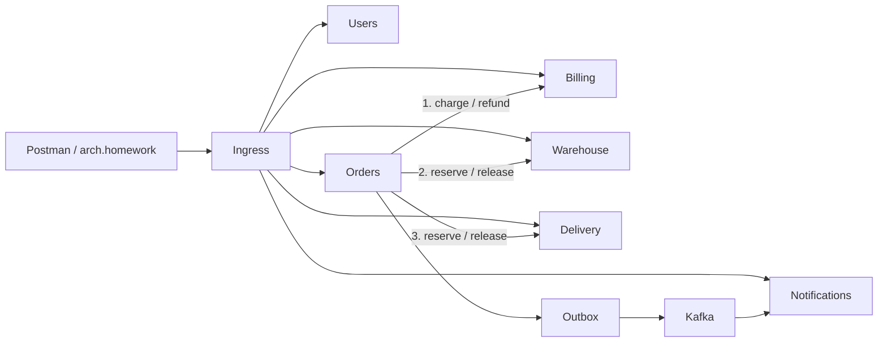

# Распределённые транзакции

## Паттерн

Заказ оформляется через **оркестрируемую Saga**. Orders управляет тремя шагами;
каждый участник фиксирует изменения в собственной PostgreSQL-базе.

| Шаг | Сервис | Действие | Компенсация |
|---|---|---|---|
| `payment` | Billing | Списать стоимость заказа | Вернуть деньги |
| `stock` | Warehouse | Зарезервировать SKU в указанном количестве | Освободить товар |
| `delivery` | Delivery | Зарезервировать конкретного курьера на временной слот | Освободить слот |

При успехе всех шагов заказ получает `status: paid`, `step: done`.
При отказе или сетевой ошибке выполняется откат в обратном порядке:
`undo_delivery → undo_stock → undo_payment`. Статус `rejected` устанавливается
после подтверждения всех компенсаций. Причина отказа сохраняется в `reason`.

Незавершённая сага имеет статус `processing` или `compensating`. Её состояние
сохраняется до внешнего вызова и после каждого шага. Фоновый worker продолжает
обработку после перезапуска Orders. Если ответ участника потерялся после commit,
повтор команды с тем же `orderId` возвращает сохранённый результат.

Отмена сохраняется и при отсутствии исходной операции: запоздавший запрос
не создаст списание или резерв после отката. Повторная компенсация не возвращает
деньги или товар второй раз. Пока участник недоступен, заказ остаётся
`compensating` и повторяет откат после его восстановления.

[Восстановление после сбоя и диагностика](recovery.md).

## Архитектура



У каждого сервиса собственная БД. Служебные команды защищены `X-Service-Key`
и доступны только внутри кластера. Публичные API используют Bearer-сессию Users;
платёж, заказ и резервы доступны владельцу. Конкурентные операции сериализуются
блокировками PostgreSQL, не допуская перерасхода денег, товара или слота.

Итог заказа и событие outbox записываются одной локальной транзакцией.
Notifications получает событие через Kafka и сохраняет одно итоговое письмо.
[Схема сервисов](architecture.mmd), [последовательность отката](compensation.mmd).

## API

```http
POST http://arch.homework/orders
Authorization: Bearer <accessToken>
Idempotency-Key: <UUID>
Content-Type: application/json

{"price":3000,"sku":"SKU-1","quantity":2,"slotId":"slot-0001"}
```

`price` — полная стоимость заказа в целых копейках RUB, диапазон
`1..1000000000000`; `quantity` — количество товара, `1..10000`.
Ключ `Idempotency-Key` обязателен. Новая завершённая сага возвращает `201`,
повтор с прежним ключом и телом — `200` с тем же заказом, незавершённая — `202`.
Ответ содержит `Location: /orders/{id}`. Изменённое тело с прежним ключом даёт
`409`, некорректные параметры — `400`. Бизнес-отказ возвращается как заказ
со статусом `rejected`.

| Метод | Назначение |
|---|---|
| `POST /auth/register`, `POST /auth/login` | Регистрация, создание счёта и вход |
| `POST /billing/deposits`, `GET /billing/account` | Пополнение и баланс |
| `GET /billing/payments/{orderId}` | Результат оплаты и возвращённая сумма |
| `POST /orders`, `GET /orders/{id}` | Создание и состояние заказа |
| `GET /warehouse/products` | SKU и доступное количество |
| `GET /warehouse/reservations/{orderId}` | Резерв товара |
| `GET /delivery/slots` | Курьер, время начала/окончания и доступность |
| `GET /delivery/reservations/{orderId}` | Резерв курьера |
| `GET /notifications?orderId={id}` | Итоговое письмо |

Начальные данные: `SKU-1` — 100000 единиц, `SKU-EMPTY` — 0;
1000 слотов разных курьеров `slot-0001..slot-1000` на 15.01.2030, 10:00–12:00 UTC.
Postman выбирает свободный слот. Каждый успешный заказ занимает один слот;
повторные миграции сохраняют остатки и резервы.

## Установка

Требуются Docker Desktop с Linux containers, PowerShell 7 и kubectl.
Скрипт скачивает kind и Helm при их отсутствии, собирает шесть образов `9.0.0`
и устанавливает приложение:

```powershell
./scripts/setup-saga.ps1
```

Кластер — `otus-hw9`, kubeconfig — `.local/kubeconfig-saga`, адрес —
`http://127.0.0.1:8099`. API, PostgreSQL и Kafka размещаются в namespace **`blt`**,
ingress controller — в **`ingress-nginx`**.

Установка в подготовленный кластер с ingress класса `nginx`, default
StorageClass и доступными узлам образами:

```powershell
kubectl create namespace blt --dry-run=client -o yaml | kubectl apply -f -
helm upgrade --install blt-saga ./helm/blt-saga --namespace blt --wait --wait-for-jobs --timeout 10m
```

Для локального кластера добавьте `--kubeconfig .local/kubeconfig-saga`.
Если Helm отсутствует в PATH, используйте `.tools/helm/windows-amd64/helm.exe`.

Сборка образов при ручной установке:

```powershell
docker build --platform linux/amd64 -t vafomenko/blt-users-api:9.0.0 .
foreach ($service in @('Billing','Orders','Notifications','Warehouse','Delivery')) {
    $imageName = 'vafomenko/blt-' + $service.ToLowerInvariant() + '-api:9.0.0'
    docker build --platform linux/amd64 -f Dockerfile.streaming --build-arg "SERVICE=$service" -t $imageName .
}
```

В kind образы загружаются через `kind load docker-image`; для внешнего кластера
опубликуйте их в registry и задайте `image.registry` в values.
Чарт создаёт сервисы, базы с PVC, Kafka, ingress и миграции.
Пароли задаются через `database.password` и `internalApiKey`;
при повторной установке с прежними PVC пароль БД должен оставаться прежним.

## Postman

Импортируйте [коллекцию](../../postman/homework-9.postman_collection.json)
и [окружение](../../postman/homework-9.postman_environment.json).
Initial значение `{{baseUrl}}` в обоих файлах — **`http://arch.homework`**.
Домен должен разрешаться в адрес ingress. Для локального стенда:

```powershell
./scripts/test-saga.ps1 -BaseUrl http://127.0.0.1:8099
```

При переопределении URL коллекция передаёт `Host: arch.homework`.
С настроенным DNS или hosts:

```powershell
npx --yes newman@6.2.1 run postman/homework-9.postman_collection.json --environment postman/homework-9.postman_environment.json --reporters cli --delay-request 200 --timeout 180000 --timeout-request 30000 --bail
```

Коллекция выполняется целиком и создаёт уникальных пользователей и ключи.
Проверяет успешный заказ, отказ каждого из трёх участников, возврат денег
и резервов, повторные запросы, конфликт ключа, валидацию, изоляцию пользователей
и итоговые уведомления. Опрос заказа и письма ограничен 60 повторами.
Отчёт сохраняется в `.local/saga-results`.

## Автотесты

```powershell
dotnet test Blt.slnx
./scripts/test-saga-recovery.ps1
```

.NET-тесты используют временный PostgreSQL-контейнер с отдельными базами.
Kubernetes-тест перезапускает участников и принудительно завершает Orders
во время незавершённой саги. [Результаты](../results/saga/README.md).
