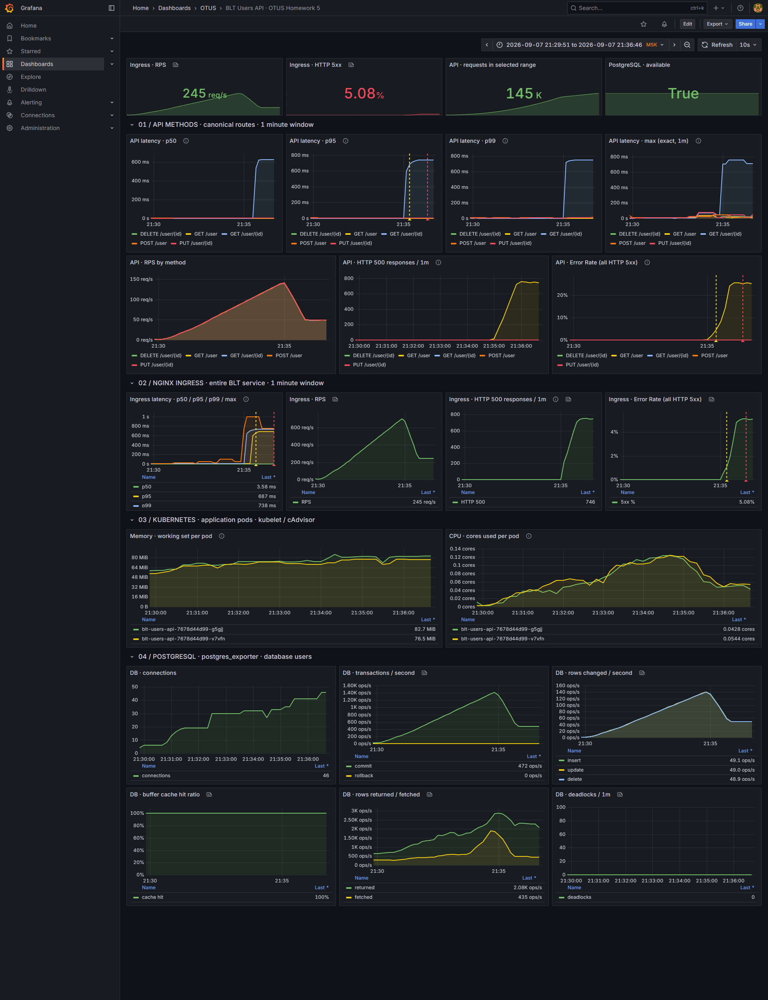
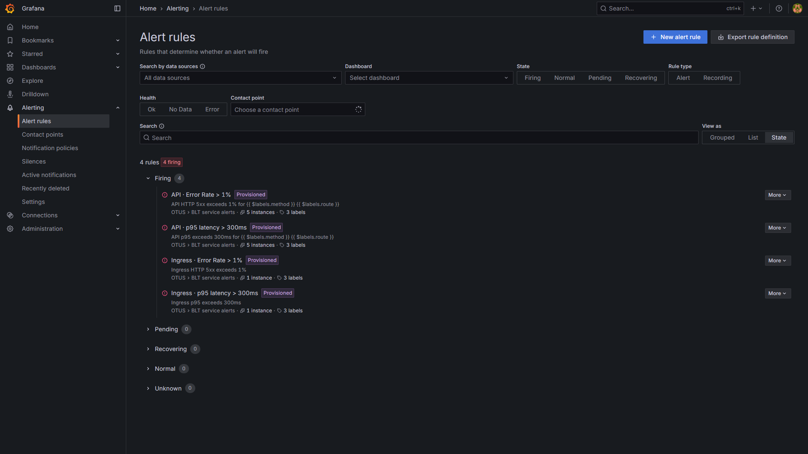
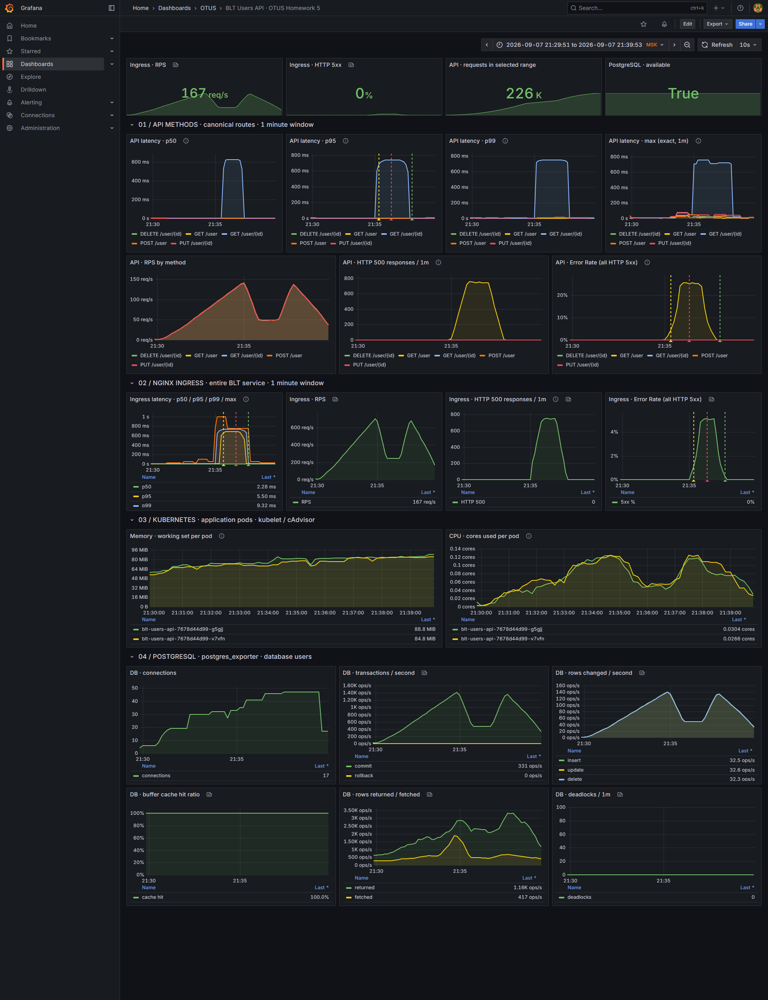

# Скриншоты Grafana

Все изображения сняты установленным Google Chrome с работающей Grafana.
Источники - Prometheus scrape
реального Kubernetes-стенда. Основной тест: 07.09.2026, 21:29:51–21:39:53 MSK.

| Файл | Что видно |
|---|---|
| [dashboard-stress.png](dashboard-stress.png) | Дашборд около 6:55 нагрузки: API, ingress, CPU/RAM, PostgreSQL; участок введённых задержек и HTTP 500 |
| [alerts-stress.png](alerts-stress.png) | Все четыре правила в состоянии Firing |
| [dashboard-recovery.png](dashboard-recovery.png) | Полный десятиминутный интервал с восстановлением latency и Error Rate |
| [alerts-recovery.png](alerts-recovery.png) | Четыре Normal, ни одного Firing |
| [ingress-latency.png](ingress-latency.png) | Крупный график p50/p95/p99/max ingress с полной легендой |

`max (histogram estimate)` - оценка максимума по стандартной гистограмме
контроллера; точный maximum приложения показан отдельной метрикой.
Подробности - [описание метрик](../monitoring.md).
Точное время съёмки и интервал данных: [stress](../results/capture-stress.json),
[recovery](../results/capture-recovery.json). Состояния алертов дополнительно
сохранены из API Grafana в JSON.

