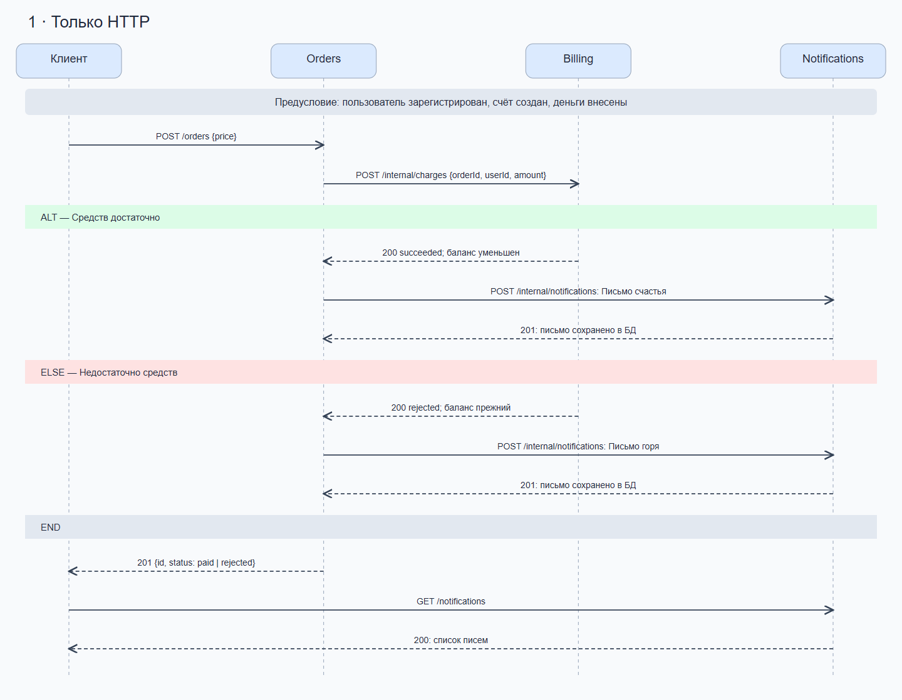
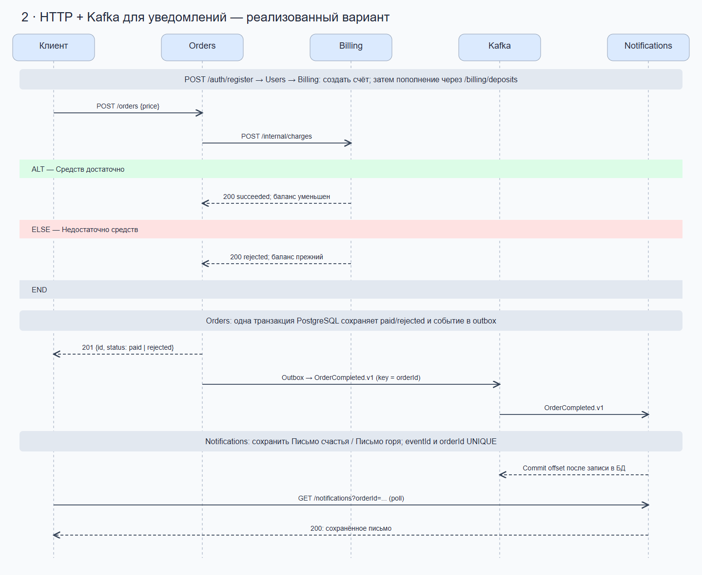
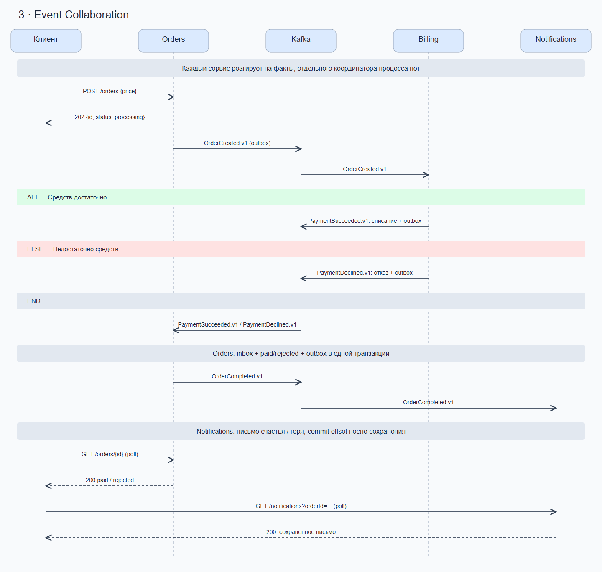
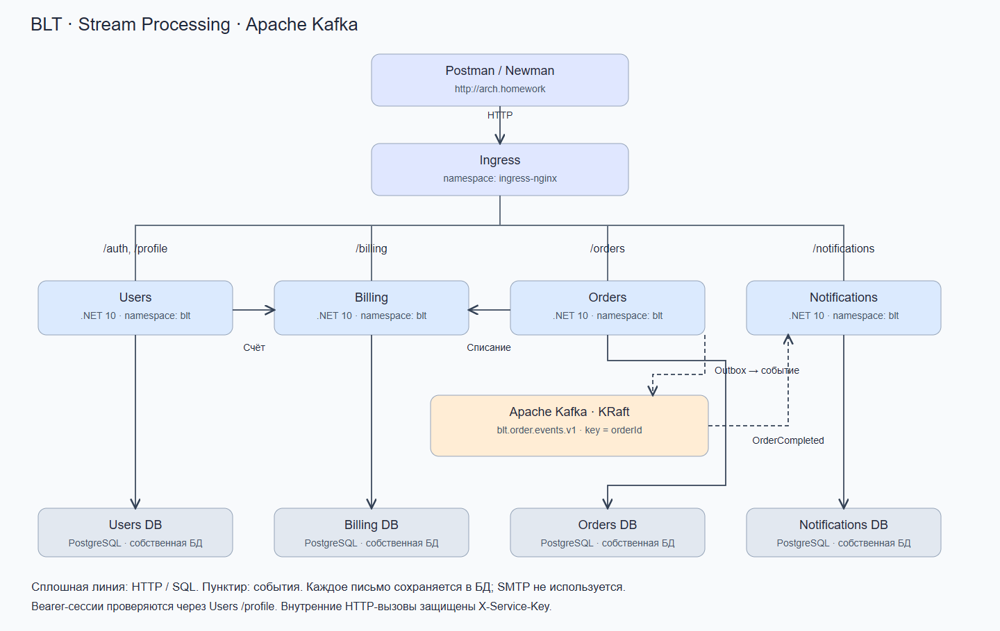

# ДЗ №8 — Stream Processing

Users, Orders, Billing и Notifications на .NET 10, собственная PostgreSQL у
каждого сервиса и Apache Kafka для событий. Внешний адрес — `http://arch.homework`.

## Теоретическая часть

Общее предусловие: `POST /auth/register` создаёт пользователя в Users, затем
Users вызывает `POST /internal/accounts` в Billing. Ответ `201` возвращается
после создания счёта. Счёт начинается с нуля; повторное создание не обнуляет
баланс. После входа пользователь пополняет счёт через `POST /billing/deposits`.

### 1. Только HTTP

Orders создаёт заказ, вызывает Billing и получает результат списания. Затем
вызывает Notifications по HTTP с письмом счастья или горя. Notifications
сохраняет сообщение и отвечает `201`; после этого Orders отвечает клиенту.
Недостаток денег — бизнес-результат `rejected`, а не транспортная ошибка.
Баланс при отказе не меняется.

Преимущество — простой последовательный процесс. Время ответа включает
сохранение письма; Orders зависит от доступности обоих сервисов.



IDL: [OpenAPI 3.0](http-only.openapi.yaml). Внутренние методы:
`POST /internal/accounts`, `POST /internal/charges`,
`POST /internal/notifications`. [Mermaid](http-only.mmd), [SVG](http-only.svg).

### 2. HTTP и события для уведомлений

Orders синхронно вызывает Billing. Получив `succeeded` или `rejected`, он
сохраняет итоговый статус и `OrderCompleted.v1` в outbox одной транзакцией.
Клиент получает `201` с результатом. Фоновый издатель переносит событие в Kafka,
а Notifications независимо сохраняет соответствующее письмо. Для получения
письма клиент опрашивает API: обработка события занимает некоторое время.

Результат оплаты доступен немедленно, а скорость обработки уведомлений не
влияет на время HTTP-ответа. Появляются Kafka, outbox и eventual consistency
списка сообщений.



IDL: [OpenAPI](openapi.yaml) и [AsyncAPI 2.6](notifications.asyncapi.yaml).
Топик `blt.order.events.v1`, событие `com.blt.order.completed.v1`, ключ —
`orderId`. [Mermaid](http-kafka.mmd), [SVG](http-kafka.svg).

### 3. Event Collaboration

Orders сохраняет заказ `processing` и событие `OrderCreated.v1`, возвращая
`202 Accepted`. Billing подписан на это событие и сам решает, можно ли списать
деньги. Он публикует `PaymentSucceeded.v1` либо `PaymentDeclined.v1`. Orders
подписан на результат платежа: завершает заказ и публикует `OrderCompleted.v1`.
Notifications реагирует на завершение и сохраняет письмо. Каждый участник
реагирует на факт своей предметной области; отдельного координатора,
рассылающего команды шагам процесса, нет.

Заказ и письмо доступны через polling. Разные подписчики используют разные
consumer groups. Billing обрабатывает `OrderCreated`, игнорируя `OrderCompleted`
в том же топике; Notifications делает наоборот. Inbox и бизнес-ключи защищают
от повторного списания и письма. Разные заказы одного счёта сериализуются
блокировкой строки в Billing: ключ Kafka `orderId` не даёт порядка по userId.

Преимущество — независимая обработка и масштабирование участников. Цена —
промежуточный статус, больше событий, потребителей и контрактов; результат
списания не входит в ответ на создание заказа.



IDL: [OpenAPI](collaboration.openapi.yaml) и
[AsyncAPI](collaboration.asyncapi.yaml). Топики:
`blt.order.events.v1` и `blt.billing.events.v1`.
[Mermaid](event-collaboration.mmd), [SVG](event-collaboration.svg).

### 4. Выбор

**Выбран и реализован вариант 2.** У процесса два шага: списание и письмо.
HTTP позволяет сразу сообщить результат списания, Kafka отделяет уведомления
от оформления заказа. По условию сбои сервисов не рассматриваются, поэтому
распределённая saga для этих двух шагов не требуется.

## Практическая часть



| Сервис | Собственные данные | Взаимодействия |
|---|---|---|
| Users | Пользователи, хеши паролей, сессии | Создаёт счёт в Billing; проверяет Bearer-сессии |
| Billing | Счета, журнал операций | Создание счёта, пополнение, снятие, оплата заказа |
| Orders | Заказы, outbox | Получает результат Billing по HTTP, публикует событие в Kafka |
| Notifications | Письма, ключи обработанных событий | Потребляет Kafka, предоставляет API отправки и списка |

Общая библиотека `Blt.Streaming` содержит инфраструктуру и типы контрактов.
Сервисы собираются в отдельные образы и запускаются в отдельных Deployment.
Ни один сервис не читает чужую БД.

Суммы — **целое число копеек RUB**. `price: 3000` означает 30 рублей.
Для операции допустимо `1..1000000000000`; дробные и отрицательные значения
возвращают `400`. Учебное пополнение не использует внешнего платёжного провайдера.
У заказа после списания статус `paid` или `rejected`; отказ содержит
`reason: insufficient_funds`.

Billing выполняет операции в транзакции с `SELECT … FOR UPDATE` по счёту.
Проверка денег, изменение баланса и запись результата выполняются под одной
блокировкой. ID операции уникален в пределах пользователя. Повтор с прежними
параметрами возвращает сохранённый результат; с изменёнными — `409`.
Для оплаты ключ операции равен ID заказа. Отказ тоже сохраняется, поэтому
повтор отказавшей оплаты после пополнения не становится новым списанием.

Orders атомарно записывает итоговый статус и outbox. Издатель ждёт подтверждения
Kafka (`acks=all`, idempotent producer), затем отмечает событие опубликованным.
Notifications подтверждает offset после записи в PostgreSQL. Уникальные
`event_id` и `order_id` обеспечивают одно письмо при повторной доставке.
Транспорт — at least once; сквозная транзакция PostgreSQL–Kafka не используется.
Стенд содержит один Kafka broker/controller в режиме KRaft, три партиции и
replication factor 1. Данные Kafka и всех БД лежат на PVC.

Публичные методы требуют Bearer-сессию из Users. Каждый новый сервис проверяет
её через `GET /profile` и берёт ID и email из профиля. Клиент не выбирает чужой
счёт или адресата. Чужой заказ возвращает `404`, список писем содержит только
собственные сообщения. Служебные HTTP-методы защищены `X-Service-Key` и не
маршрутизируются ingress.

Условия задания позволяют не обрабатывать остановку процесса между записью
пользователя и созданием счёта или между ответом Billing и завершением заказа.
Outbox обеспечивает доставку уже сохранённого результата, но не восстанавливает
незавершённый HTTP-процесс. SMTP не используется: отправка — это запись в БД.

## Установка

Требуются Docker Desktop с Linux containers, PowerShell 7 и kubectl. Скрипт
использует kind и Helm, при отсутствии скачивает их в `.tools`. Создаёт отдельный
кластер **`otus-hw8`** и kubeconfig **`.local/kubeconfig-streaming`**, собирает
четыре образа `8.0.0` и загружает их в kind. Порт `127.0.0.1:8098`,
Docker-подсеть `10.208.8.0/24`.

```powershell
./scripts/setup-streaming.ps1
./scripts/test-streaming.ps1 -BaseUrl http://127.0.0.1:8098
```

Namespaces: **`blt`** — четыре API, четыре PostgreSQL, Kafka и Job создания
топика; **`ingress-nginx`** — ingress controller.

Команда установки приложения в подготовленный кластер:

```powershell
helm upgrade --install blt-streaming ./helm/blt-streaming --namespace blt --create-namespace --wait --wait-for-jobs --timeout 10m
```

Для созданного скриптом кластера явно добавляйте
`--kubeconfig .local/kubeconfig-streaming` к Helm/kubectl. Если Helm отсутствует
в PATH, используйте `.tools/helm/windows-amd64/helm.exe`.

Перед ручной установкой нужны ingress controller с классом `nginx`, default
StorageClass и доступные узлам образы. Внешний кластер получает их из вашего
registry; локальный kind — через `kind load docker-image`. Сборка:

```powershell
docker build --platform linux/amd64 -t vafomenko/blt-users-api:8.0.0 .
docker build --platform linux/amd64 -f Dockerfile.streaming --build-arg SERVICE=Billing -t vafomenko/blt-billing-api:8.0.0 .
docker build --platform linux/amd64 -f Dockerfile.streaming --build-arg SERVICE=Orders -t vafomenko/blt-orders-api:8.0.0 .
docker build --platform linux/amd64 -f Dockerfile.streaming --build-arg SERVICE=Notifications -t vafomenko/blt-notifications-api:8.0.0 .
```

Чарт включает PostgreSQL, Kafka, PVC, ConfigMaps, Secret, Services, Deployments,
Ingress и Job создания топика. Init containers применяют миграции перед API.
Для общего кластера задайте `database.password` и `internalApiKey` приватным
values-файлом; значения по умолчанию предназначены для локального стенда.
При повторном использовании PVC пароль должен остаться прежним.

## Postman и Newman

Импортируйте [коллекцию](../../postman/homework-8.postman_collection.json) и
[окружение](../../postman/homework-8.postman_environment.json).
Все URL используют `{{baseUrl}}`. Initial/default значение в обоих файлах —
**`http://arch.homework`**. Домен должен разрешаться в адрес ingress.
Для локального стенда можно переопределить URL на `http://127.0.0.1:8098`:
коллекция передаёт `Host: arch.homework`, менять системный hosts не требуется.

```powershell
npx --yes newman@6.2.1 run postman/homework-8.postman_collection.json --environment postman/homework-8.postman_environment.json --reporters cli --color off --delay-request 200 --timeout 180000 --timeout-request 15000 --bail
```

Newman печатает метод, URL, заголовки, тело запроса, HTTP-статус и тело ответа.
Пароли и токены маскируются. Не добавляйте `--reporter-cli-no-console`.

Основной сценарий:

1. Зарегистрировать уникального пользователя и войти; проверить нулевой счёт.
2. Внести `10000` копеек.
3. Создать заказ на `3000`; проверить `paid` и баланс `7000`.
4. Дождаться «Письма счастья» с нужными email, userId и orderId.
5. Создать заказ на `8000`; проверить `rejected`, `insufficient_funds`, баланс `7000`.
6. Дождаться «Письма горя»; проверить ровно два письма для двух заказов.

Дополнительно: чтение заказа, невалидные суммы, прямое снятие денег, идемпотентный
повтор и конфликт ключа, API отправки сообщения, отсутствие анонимного доступа
и изоляция двух пользователей. Итог после прямого снятия `500` копеек — `6500`;
второй пользователь имеет нулевой счёт. Polling ограничен 60 повторами: по
истечении лимита тест падает. Каждый запуск использует новых пользователей и ID.

## Проверки и материалы

```powershell
dotnet test Blt.slnx
helm lint ./helm/blt-streaming
kubectl --kubeconfig .local/kubeconfig-streaming -n blt get pods
kubectl --kubeconfig .local/kubeconfig-streaming -n blt exec blt-streaming-kafka-0 -- /opt/kafka/bin/kafka-consumer-groups.sh --bootstrap-server localhost:9092 --describe --group blt.notifications.v1
```

.NET-тесты создают временные PostgreSQL и удаляют контейнеры после выполнения.
Результаты — [docs/results/streaming](../results/streaming/README.md).
Диаграммы поставляются как PNG, SVG и Mermaid. Повторная генерация:

```powershell
python scripts/generate-streaming-diagrams.py
npm install --prefix .tools/browser playwright@1.55.0
node scripts/render-streaming-diagrams.cjs
```

Рендеринг использует установленный Microsoft Edge в headless-режиме.

Документация технологий: [Apache Kafka Docker](https://kafka.apache.org/41/getting-started/docker/),
[Confluent .NET и offsets](https://docs.confluent.io/kafka-clients/dotnet/current/overview.html),
[AsyncAPI](https://www.asyncapi.com/docs).
